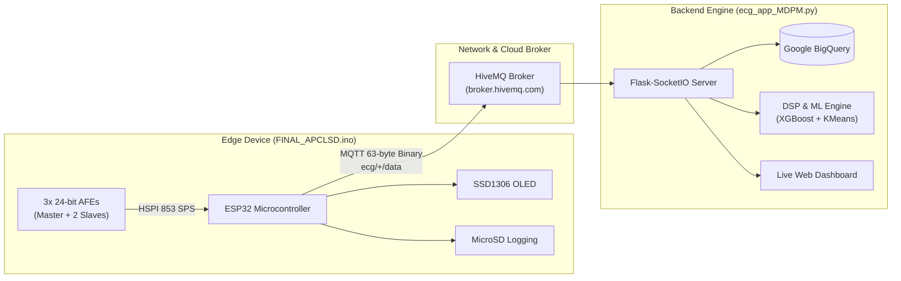

# 12-Lead Smart Holter Platform

[](https://www.python.org/downloads/)
[](https://www.espressif.com/en/products/socs/esp32)
[](https://www.hivemq.com/)
[](https://cloud.google.com/bigquery)
[](https://github.com/neuropsychology/NeuroKit)

An end-to-end, medical-grade IoT platform for continuous, real-time 12-lead electrocardiogram (ECG) acquisition, high-throughput cloud streaming, digital signal processing (DSP), and automated arrhythmia screening.

Developed by **CTAI Laboratory**, this system couples an ultra-low-power ESP32 edge acquisition Holter with a scalable Google Cloud Platform (GCP) ingestion and analytics backend.

---

## 📚 Technical Documentation Index

For exhaustive technical references, consult the dedicated guides in the [`docs/`](docs) directory:

| Document | Primary Topics Covered |
| :--- | :--- |
| **[System Architecture & Data Flow](docs/architecture_and_dataflow.md)** | End-to-end topology, Mermaid sequence diagrams, multi-device lifecycle, background tasks. |
| **[Hardware & Pinout Specification](docs/hardware_and_pinout.md)** | Pinout matrix, cascaded ADS1293 Master/Slave registers, lead derivation math, battery divider. |
| **[Binary Telemetry Protocol Specification](docs/binary_protocol_spec.md)** | 63-byte cloud metrics & 51-byte legacy packet layouts, checksum algorithm, QoS latency & jitter. |
| **[DSP & Machine Learning Pipeline](docs/dsp_and_ml_pipeline.md)** | IEC 60601-2-51 filtering, Symlet-6 wavelet denoising, 96-feature extraction, XGBoost & K-Means. |
| **[API & BigQuery Schema Reference](docs/api_and_bigquery_reference.md)** | REST endpoints (`/api/history`), WebSocket event signatures, BigQuery table DDL schemas. |
| **[Deployment & Configuration Guide](docs/deployment_guide.md)** | GCP Compute Engine VM tutorial, systemd service units, firewall rules, environment variables. |

---

## 🌟 Key Features

* **True 12-Lead Acquisition**: Captures 8 physical channels simultaneously across 3 cascaded 24-bit analog front-ends (AFEs) at **$853\text{ SPS}$**, synthesizing the remaining 4 limb leads in real time.
* **4-in-1 Operating Modes**:
  1. `SELECT_MODE`: Interactive captive portal over local soft-AP (`ESP32-ECG-AP`) to select running mode.
  2. `AP_MODE`: Local bedside TCP streaming on port 8888 for real-time serial/socket inspection.
  3. `SD_CARD_MODE`: High-speed binary recording to FAT32 MicroSD card with embedded web file browser.
  4. `CLOUD_MODE`: `WiFiManager` captive WiFi setup, NTP microsecond synchronization, and 63-byte binary MQTT telemetry streaming.
* **High-Throughput Cloud Backend**:
  * Python `eventlet` asynchronous engine handling multiple concurrent ESP32 Holters.
  * Real-time network QoS telemetry: packet loss tracking, transit latency, and rolling jitter calculation.
  * Decoupled batching ingestion into Google BigQuery tables: `ecg_raw_per_sample` and `ecg_performance_metrics`.
* **Clinical-Grade DSP & Machine Learning**:
  * Edge desaturation and Hampel impulse despiking.
  * IEC 60601-2-51 compliant bandpass filter ($0.05\text{--}150\text{ Hz}$) with $50\text{ Hz}$ zero-phase IIR notch.
  * Symlet-6 discrete wavelet denoising with protected cardiac frequency bands ($1.0\text{--}40.0\text{ Hz}$).
  * 96-feature extraction (morphology, intervals, QTc, and ratios) using `neurokit2`.
  * Two-stage classification: **XGBoost** binary classifier (Normal vs Arrhythmia) + **K-Means** clustering (Slow Bradyarrhythmia vs Fast Tachyarrhythmia).
* **Responsive Multi-Device Web UI**:
  * Zero-lag waveform plotting with Chart.js powered by `requestAnimationFrame`.
  * Multi-device overview table with live QoS statistics.
  * Instant classification history viewer linked to BigQuery.

---

## 🏗️ System Architecture



---

## ⚡ Binary Protocol Summary

To stream $853\text{ SPS}$ across 12 channels without network saturation, telemetry is packed into a compact **63-byte binary frame**:

```
+--------+------------------------+-------------------+-----------------------------+----------+--------+
| STX    | Timestamp (microsec)   | Packet Counter    | 12-Lead ECG Data            | Checksum | ETX    |
| (0x02) | 8 Bytes (uint64_t)     | 4 Bytes (uint32_t)| 48 Bytes (12 x int32_t)     | 1 Byte   | (0x03) |
+--------+------------------------+-------------------+-----------------------------+----------+--------+
 Byte 0   Byte 1            Byte 8 Byte 9      Byte 12 Byte 13               Byte 60 Byte 61    Byte 62
```

* **Lead Packing Order**: `lead_I`, `lead_II`, `lead_III`, `avr`, `avl`, `avf`, `v1`, `v2`, `v3`, `v4`, `v5`, `v6` (all 32-bit signed integers, Little-Endian).
* **Python Unpack Directive**: `struct.unpack('<QI12i', payload[1:61])`
* **Checksum**: $\sum_{i=1}^{60} \text{payload}[i] \pmod{256}$

*For the legacy 51-byte bedside AP format and full details, see [docs/binary_protocol_spec.md](docs/binary_protocol_spec.md).*

---

## 🔌 Hardware Pinout Overview

| Peripheral | ESP32 Pin | Signal / Function | Description |
| :--- | :--- | :--- | :--- |
| **ECG SPI** | GPIO 14 | `PIN_SCLK_ECG` | HSPI Clock (1.0 MHz, Mode 0) |
| | GPIO 12 | `PIN_MISO_ECG` | HSPI Master In, Slave Out |
| | GPIO 13 | `PIN_MOSI_ECG` | HSPI Master Out, Slave In |
| | GPIO 25 | `PIN_DRDYB` | Master Data Ready Interrupt (Active LOW) |
| **Chip Selects**| GPIO 33 | `PIN_SS_MASTER` | Master AFE Select (Leads I, II) |
| | GPIO 4 | `PIN_SS_SLAVE1` | Slave 1 AFE Select (V1, V2, V3) |
| | GPIO 2 | `PIN_SS_SLAVE2` | Slave 2 AFE Select (V4, V5, V6) |
| **OLED (I2C)** | GPIO 21 | SDA | SSD1306 Serial Data (Address `0x3C`) |
| | GPIO 22 | SCL | SSD1306 Serial Clock |
| **MicroSD** | GPIO 15 | `PIN_CS_SD` | VSPI MicroSD Chip Select |
| **Battery** | GPIO 34 | `BATTERY_PIN` | ADC1_CH6 2S Li-ion voltage divider ($\times 3.24$) |

*For register configuration maps and wiring schematics, see [docs/hardware_and_pinout.md](docs/hardware_and_pinout.md).*

---

## 🚀 Quickstart & Deployment

### 1. Backend Installation (Local or VM)
Clone the repository and install dependencies:
```bash
git clone https://github.com/your-username/12LeadSmartHolterDev.git
cd 12LeadSmartHolterDev
python -m venv venv
source venv/bin/activate  # On Windows: venv\Scripts\activate
pip install -r requirements.txt
```

### 2. Configure Environment Variables
Create a `.env` file in the project root:
```ini
GCP_PROJECT_ID=your-gcp-project-id
DATASET_ID=ecg_data
MODEL_PATH=/path/to/ecg_models
FLASK_PORT=5000
MQTT_BROKER=broker.hivemq.com
MQTT_PORT=1883
MQTT_TOPIC=ecg/+/data
```

### 3. Place ML Models
Ensure the three required model files reside in `MODEL_PATH`:
* `scaler.joblib`
* `model_xgb_binary.joblib`
* `kmeans_abnormal_model.joblib`

### 4. Run the Server
```bash
python ecg_app_MDPM.py
```
Open `http://localhost:5000` in your web browser.

*For automated production deployment using GCP Compute Engine and systemd, consult [docs/deployment_guide.md](docs/deployment_guide.md).*

---

## 🩺 Operational Workflow

1. **Power On the ESP32 Device**:
   * Upon boot, the ESP32 initializes peripherals and enters `SELECT_MODE`.
   * The OLED display prompts the user to connect to the local configuration Access Point.
2. **Select Operating Mode**:
   * Connect your laptop or mobile phone to the Wi-Fi network `ESP32-ECG-AP` (Password: `password123`).
   * Navigate to `http://192.168.4.1` in your browser and click **Start Cloud Upload Mode**.
3. **Network Configuration (WiFiManager)**:
   * If local Wi-Fi credentials are not yet saved, the captive configuration portal opens automatically.
   * Select your local Wi-Fi SSID, input the password, and save.
   * Once connected, the ESP32 synchronizes POSIX microsecond timestamps via NTP and begins continuous MQTT streaming.
4. **Monitor the Web Dashboard**:
   * Access the backend web application at `http://[SERVER_IP]:5000`.
   * Select your device ID (e.g., `device_01`) from the dropdown selector.
   * The live Lead II waveform and 12-lead raw ADC values will immediately begin rendering in real time.
5. **Diagnostic Recording & Classification**:
   * Input the patient or subject ID (e.g., `Patient_001`) into the Subject ID field.
   * Click **Start Recording**.
   * The server buffers an 8,000-sample recording ($\approx 9.37\text{ seconds}$).
   * Upon buffer completion, the server automatically executes the clinical DSP and Machine Learning pipeline.
   * The diagnosis (`Normal`, `Potential Slow Arrhytmia`, or `Potential Fast Arrhytmia`) is stored in BigQuery and rendered in the Classification History table.

---

## 📄 License & Attribution

Developed under the research initiative of **CTAI Laboratory**. All signal processing algorithms and diagnostic models comply with IEC 60601-2-51 safety and diagnostic standards.
