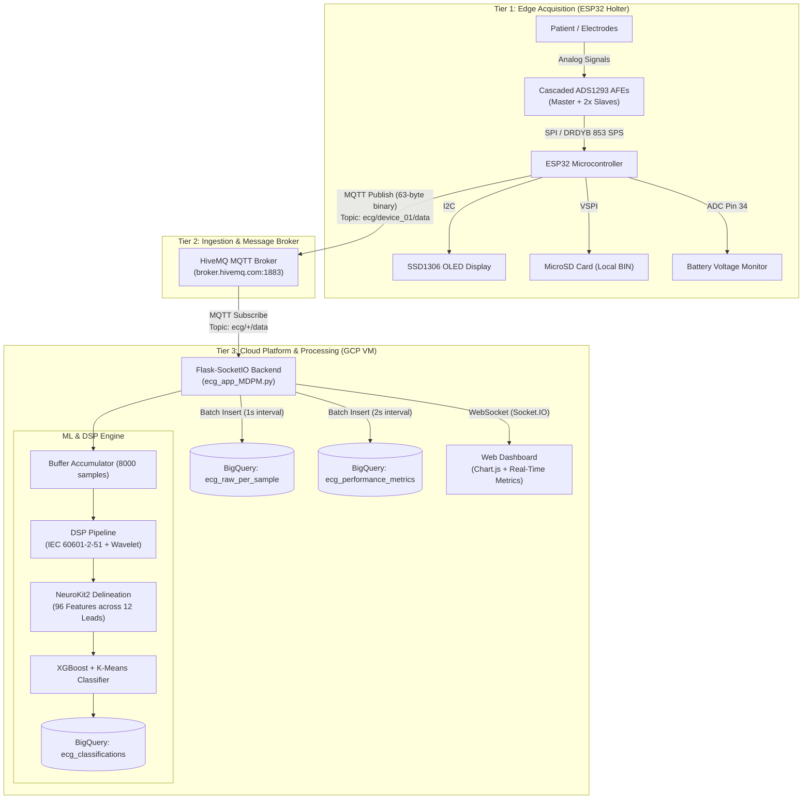
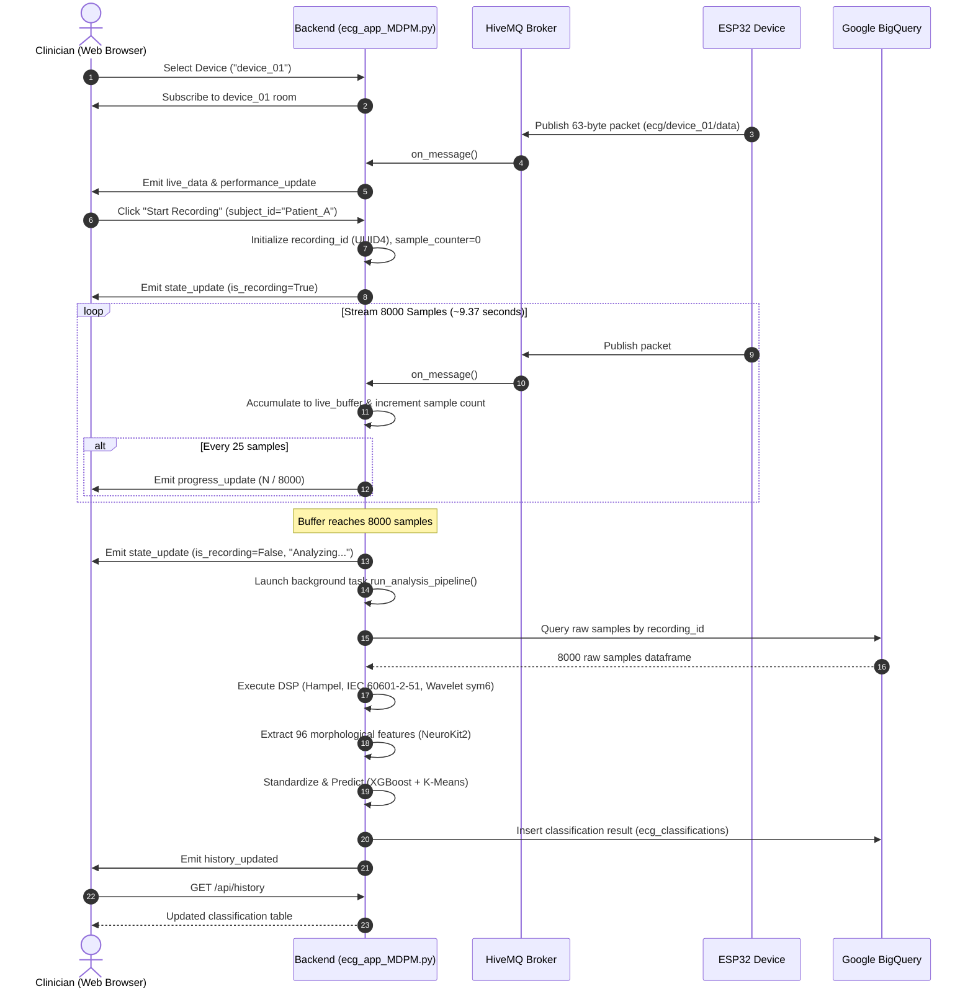
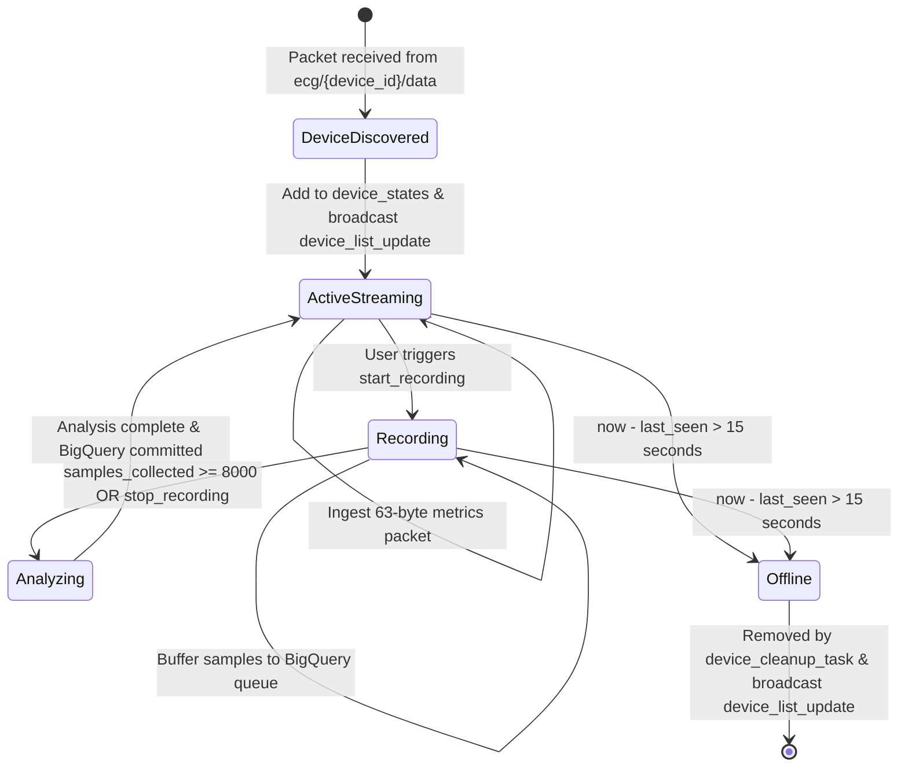

# System Architecture & Data Flow

This document details the architectural design, component interactions, and data flow of the **12-Lead Smart Holter System**.

---

## 1. High-Level System Architecture

The system follows a three-tier distributed architecture designed for real-time biomedical telemetry, high-throughput ingestion, and cloud-based machine learning classification:

---

## 2. Component Roles & Responsibilities

### 2.1 Hardware Edge Device (`FINAL_APCLSD.ino`)
* **ECG Front-End**: Reads 8 physical differential ECG channels via three analog front-end (AFE) chips over high-speed SPI (HSPI at 1 MHz) synchronized by the `DRDYB` interrupt pin.
* **Lead Derivation**: Uses Einthoven and Goldberger electrophysiology laws to synthesize 4 augmented limb leads ($Lead\ III$, $aVR$, $aVL$, $aVF$) directly in firmware.
* **Operating Modes**:
  1. `SELECT_MODE`: Initializes an open Captive Access Point (`ESP32-ECG-AP`) serving a responsive HTTP menu at `192.168.4.1`.
  2. `AP_MODE`: Opens a local TCP server on port `8888` streaming 51-byte framed binary packets for bedside inspection.
  3. `SD_CARD_MODE`: Writes uncompressed 12-lead binary data blocks to FAT32 MicroSD cards with an embedded web-based file browser.
  4. `CLOUD_MODE`: Uses `WiFiManager` with automatic fallback to captive portal, synchronizes real-world POSIX time via NTP (`pool.ntp.org`), and publishes 63-byte framed telemetry packets to HiveMQ MQTT.

### 2.2 Ingestion & Processing Backend (`ecg_app_MDPM.py`)
* **Asynchronous Multi-Device Networking**: Built on Python `eventlet` green threads with non-blocking Paho-MQTT listener and WebSocket broadcasts.
* **Network Performance Telemetry**: Tracks real-time transmission latency, jitter (standard deviation over a rolling 100-packet window), and cumulative packet loss via packet sequence tracking.
* **Dynamic Device Discovery & Lifecycle**: Maintains state dictionaries per active device ID. Automatically expires inactive devices from the dashboard if no packets arrive within `DEVICE_TIMEOUT_S` (15 seconds).
* **Dual-Buffer BigQuery Ingestion**: Decouples network packet reception from BigQuery API round-trips using thread-safe deques (`live_buffer` and `perf_buffer`) flushed on 1-second and 2-second timers.

### 2.3 Web Dashboard & Visualization
* **Rendering Performance**: Implements a `requestAnimationFrame` render loop consuming an in-memory packet buffer to prevent UI freeze during high-frequency streaming ($853\text{ SPS}$).
* **Room-Based Socket Architecture**: Web clients join device-specific Socket.IO rooms (`join_room(device_id)`), ensuring only relevant waveform streams and metrics are forwarded to the observer.
* **Real-time Diagnostic Insights**: Visualizes Lead II waveform via Chart.js, 12-lead instantaneous raw ADC cards, network health metrics, and classification history.

---

## 3. End-to-End Recording & Analysis Sequence

The sequence below illustrates the life cycle of a diagnostic recording session:

---

## 4. Multi-Device State Machine & Fault Recovery

