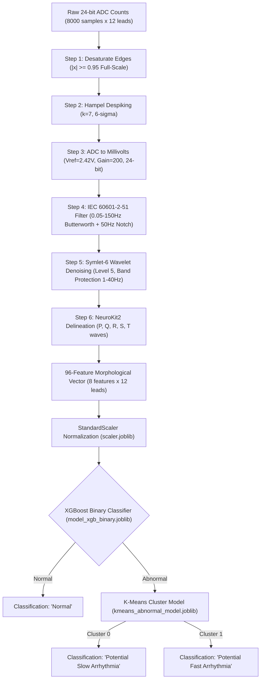

# Digital Signal Processing (DSP) & Machine Learning Pipeline

This document details the mathematical specifications, filtering algorithms, feature extraction procedures, and machine learning models implemented in `ecg_app_MDPM.py`.

---

## 1. Pipeline Overview

The analysis pipeline processes an 8,000-sample recording buffer ($\sim 9.37\text{ seconds}$ at $F_s = 853\text{ Hz}$) retrieved from Google BigQuery:



---

## 2. Digital Signal Processing (DSP) Pipeline

### Step 1: Edge Desaturation (`desaturate_edges`)
When an electrode experiences transient detachment or saturation, the 24-bit ADC rails against its maximum range. The system detects and linearly interpolates values that exceed $95\%$ of the $24\text{-bit}$ signed headroom:
$$ADC_{\text{EDGE}} = 0.95 \times (2^{23} - 1) = 7{,}969{,}176\text{ counts}$$
Any sample $x_i$ where $|x_i| \ge ADC_{\text{EDGE}}$ is masked and replaced via 1D linear interpolation across adjacent unclipped samples.

### Step 2: Hampel Outlier Despiking (`despike_hampel`)
Non-physiological high-amplitude impulse spikes (electrostatic discharge, motion artifacts) are attenuated using a Hampel identifier:
1. For each point $x_i$, compute the local median $m_i$ within a moving window of length $2k + 1$ ($k = 7$):
   $$m_i = \text{median}(x_{i-k}, \dots, x_{i+k})$$
2. Compute the Median Absolute Deviation ($MAD$):
   $$MAD_i = \text{median}(|x_{i-k} - m_i|, \dots, |x_{i+k} - m_i|)$$
3. Detect outliers exceeding $n_\sigma = 6.0$ standard deviations:
   $$\text{Mask}_i = |x_i - m_i| > 6.0 \times 1.4826 \times \max(MAD_i, 10^{-12})$$
4. Outliers are replaced using linear interpolation.

### Step 3: ADC to Physical Voltage Conversion (`to_mV`)
Converts raw integer counts to millivolts ($mV$) based on the analog front-end reference voltage and internal instrumentation amplifier gain:
$$LSB = \frac{V_{\text{REF}}}{2^{\text{RESOLUTION}} - 1} = \frac{2.42\text{ V}}{2^{24} - 1} \approx 144.24\text{ nV}$$
$$V_{\text{mV}}(x) = x \times LSB \times \frac{1000\text{ mV/V}}{\text{GAIN}} = x \times \left(\frac{2.42}{16{,}777{,}215}\right) \times \frac{1000}{200}$$
A constant detrend (`scipy.signal.detrend(..., type='constant')`) removes mean DC offsets.

### Step 4: IEC 60601-2-51 Diagnostic Filtering (`apply_iec_diagnostic_filter`)
Applies standard diagnostic-grade frequency constraints:
1. **Edge Padding**: Pads the signal by $2\text{ seconds}$ ($2 \times F_s = 1706\text{ samples}$) on both ends using edge reflection to prevent forward-backward filter ring-down distortion:
   ```python
   padded_signal = np.pad(signal, (pad_len, pad_len), mode='edge')
   ```
2. **High-Pass Filter**: 4th-order Butterworth with $f_c = 0.05\text{ Hz}$ to eliminate respiration baseline wander without phase-distorting ST segment elevation or depression.
3. **Low-Pass Filter**: 4th-order Butterworth with $f_c = 150.0\text{ Hz}$ to suppress electromyographic (EMG) muscle noise while preserving QRS high-frequency notches.
4. **Notch Filter**: Second-order IIR notch filter tuned to $f_0 = 50.0\text{ Hz}$ ($Q = 30.0$) to extinguish AC power line interference.
5. All filters use zero-phase forward-backward filtering (`scipy.signal.filtfilt`).

### Step 5: Wavelet Denoising (`wavelet_denoise`)
Applies Discrete Wavelet Transform (DWT) utilizing the **Symlet-6 (`sym6`)** mother wavelet up to level 5:
* **Universal Threshold**:
  $$\lambda = \hat{\sigma} \sqrt{2 \ln(N)}, \quad \text{where } \hat{\sigma} = \frac{\text{median}(|cD_i - \text{median}(cD_i)|)}{0.6745}$$
* **Diagnostic Frequency Band Protection**:
  High-frequency noise exists predominantly in detail levels $cD_1$ and $cD_2$. However, cardiac energy (P, QRS, T complexes) is concentrated in the $1.0\text{--}40.0\text{ Hz}$ band. The algorithm checks frequency overlaps for each decomposition level $i$:
  $$f_{\text{low}} = \frac{F_s}{2^{i+1}}, \quad f_{\text{high}} = \frac{F_s}{2^i}$$
  If $f_{\text{high}} \le 2.0\text{ Hz}$, thresholding is completely bypassed. If the band overlaps $1.0\text{--}40.0\text{ Hz}$, threshold $\lambda$ is scaled down by $0.5$ (`protect_factor = 0.5`) using soft thresholding to avoid blunting R peaks.

---

## 3. NeuroKit2 Feature Extraction (96-Dimensional Vector)

For each of the 12 leads ($I, II, III, aVR, aVL, aVF, V_1, V_2, V_3, V_4, V_5, V_6$), the pipeline extracts **8 clinical electrophysiology features**, forming a total input vector of $12 \times 8 = 96$ features:

| Feature Name | Symbol / Code Key | Diagnostic Description | Calculation Method |
| :--- | :--- | :--- | :--- |
| **RR Interval** | `rr_{lead}` | Mean duration between successive R peaks | $\overline{RR} = \frac{1}{N-1}\sum_{k=1}^{N-1} (R_{k+1} - R_k) \times \frac{1000}{F_s}\text{ ms}$ |
| **RR Std Deviation** | `rr_std_{lead}`| Heart rate variability (SDNN) | $\sigma_{RR} = \sqrt{\frac{1}{N-1}\sum (RR_k - \overline{RR})^2}$ |
| **PR Interval** | `pr_{lead}` | Atrioventricular conduction time | $PR = (R_{\text{onset}} - P_{\text{onset}}) \times \frac{1000}{F_s}\text{ ms}$ |
| **QRS Duration** | `qs_{lead}` | Ventricular depolarization duration | $(S_{\text{peak}} - Q_{\text{peak}}) \times \frac{1000}{F_s}\text{ ms}$ (Fallback: $R_{\text{offset}} - R_{\text{onset}}$) |
| **Corrected QT** | `qtc_{lead}` | Ventricular repolarization rate-corrected | Bazett's Formula: $QT_c = \frac{QT}{\sqrt{\overline{RR} / 1000\text{ s}}}$ |
| **ST Duration** | `st_{lead}` | Plateau phase of repolarization | $(T_{\text{onset}} - R_{\text{offset}}) \times \frac{1000}{F_s}\text{ ms}$ |
| **R/S Amplitude Ratio** | `rs_ratio_{lead}`| Ventricular balance / hypertrophy metric | $Ratio = \frac{\overline{Amp}(R_{\text{peaks}})}{|\overline{Amp}(S_{\text{peaks}})|}$ |
| **Heart Rate** | `heartrate_{lead}`| Instantaneous mean ventricular rate | $BPM = \frac{60{,}000}{\overline{RR}_{\text{ms}}}$ |

### Robust Fallback Algorithms
* **`_qrs_ms_from_Ronset_Roffset`**: Used if $Q$ or $S$ delineation fails due to absent or biphasic Q waves. Resolves the QRS complex directly from the $R$ onset and offset anchors.
* **`_qt_last_resort_pairing`**: Employs physiologic bounding constraints ($0.20 \times RR \le QT \le 0.60 \times RR$ with absolute bounds $[160\text{ ms}, 600\text{ ms}]$) to prevent outlier T-wave pairing mistakes during arrhythmia or tachycardia.

---

## 4. Machine Learning Classification Architecture

The machine learning subsystem employs a two-tier ensemble strategy:

```
[96-Dimensional Input Vector X]
               |
               v
     +-------------------+
     |   StandardScaler  | (scaler.joblib)
     +-------------------+
               |
               v
     +-------------------+
     | XGBoost Binary    | (model_xgb_binary.joblib)
     | Classifier        |
     +-------------------+
        /             \
       /               \
[Predict = 1]     [Predict = 0]
      |                 |
      v                 v
   "Normal"     +-------------------+
                | K-Means Clustering| (kmeans_abnormal_model.joblib)
                +-------------------+
                   /             \
                  /               \
           [Cluster 0]        [Cluster 1]
                |                  |
                v                  v
         "Potential Slow     "Potential Fast
           Arrhythmia"         Arrhythmia"
        (Bradyarrhythmia)   (Tachyarrhythmia)
```

1. **Standardization (`scaler.joblib`)**:
   Standardizes feature distributions using column-wise z-score scaling:
   $$z = \frac{x - \mu}{\sigma}$$
   Ensures missing columns are reindexed with `0.0` to preserve dimensional integrity across model versions (`scaler.feature_names_in_`).
2. **Tier 1: Binary Arrhythmia Detection (`model_xgb_binary.joblib`)**:
   A gradient boosted decision tree (XGBoost) trained to separate normal sinus rhythms from pathological rhythms:
   $$\hat{y}_{\text{binary}} = \begin{cases} 1 & \implies \text{"Normal"} \\ 0 & \implies \text{"Abnormal (Arrhythmia)"} \end{cases}$$
3. **Tier 2: Abnormal Clustering (`kmeans_abnormal_model.joblib`)**:
   Abnormal instances are routed to an unsupervised K-Means model to differentiate rate and morphology characteristics:
   $$\text{Label} = \arg\min_{k} ||z - \mu_k||^2$$
   * **Cluster 0** (Mapped to label 1): **"Potential Slow Arrhythmia"** (Characterized by prolonged RR intervals, sinus bradycardia, second/third-degree AV block).
   * **Cluster 1** (Mapped to label 2): **"Potential Fast Arrhythmia"** (Characterized by shortened RR intervals, sinus tachycardia, atrial fibrillation with rapid ventricular response, or ventricular tachycardia).

